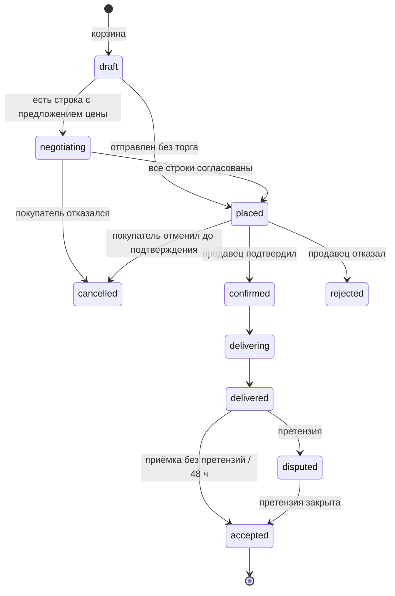
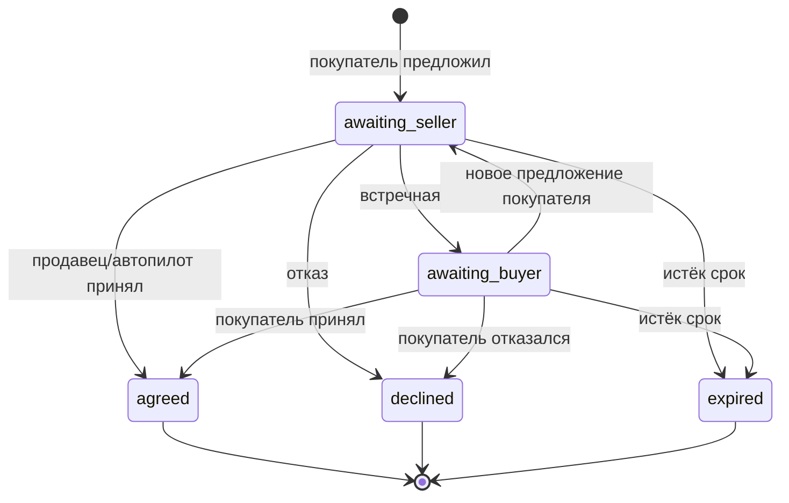
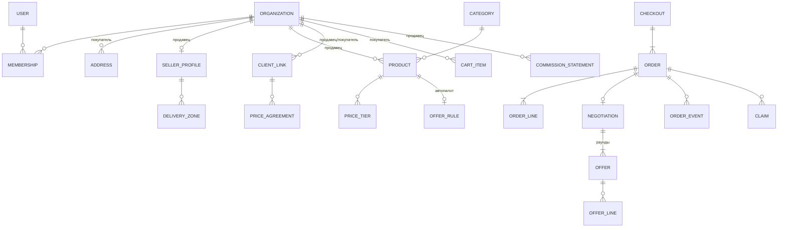

# QB — MVP для Армении: экраны, торг, модель данных, стек

> Черновик v0.1 · 21.10.2026 · опирается на [01-research-and-concept.md](01-research-and-concept.md)
> Валюта — AMD (целые драмы). Языки — армянский, русский, английский.

## 1. Цель и границы MVP

**Что проверяем:** будут ли заведения Еревана регулярно заказывать у нескольких поставщиков через одно окно, а продавцы — принимать заказы и торговаться на платформе.

**Цели на 3 месяца после запуска** (гипотезы, уточнить):
- 15–20 активных продавцов, 100+ заведений с хотя бы одним заказом;
- 40% заведений делают 2+ заказа в месяц;
- 20%+ заказов проходят через торг, из них 60%+ заканчиваются сделкой;
- медианное время ответа продавца на предложение цены — до 2 часов.

| Входит в MVP | Не входит (вторая очередь) |
|---|---|
| Каталог продавцов, поиск, фильтры | ИИ-заказ голосом или фото |
| Корзина на нескольких продавцов, разбиение на заказы | Счета и путевые листы в системе КГД (идёт параллельно как исследование API) |
| Торг: предложить цену по строке или по заказу, встречная цена, автопилот продавца | Тендеры (запрос цены у многих) |
| Контрактная цена после сделки (фиксируется на N дней) | Совместная закупка |
| Статусы заказа, приёмка, простая претензия | Онлайн-оплата, эскроу, отсрочка |
| Повтор заказа, избранное | Своя доставка |
| Приглашение клиентов продавцом (0% комиссии) | Рейтинги с отзывами (в MVP только внутренние метрики) |
| Telegram-бот: уведомления и быстрые ответы на торг | Мобильное приложение в сторах |
| Ежемесячный отчёт по комиссии для продавца | Интеграции с учётом (ArmSoft, 1С), кроме выгрузки в Excel |
| Админка для операций | Грузия |

Оплата в MVP — **вне платформы**: как сейчас (перевод, наличные, Idram), продавец отмечает «оплачено». Платформа выставляет продавцу счёт на комиссию раз в месяц.

## 2. Роли

| Роль | Кто | Что делает |
|---|---|---|
| **Покупатель-владелец** | Владелец кафе | Всё: заказы, торг, точки доставки, сотрудники |
| **Покупатель-закупщик** | Шеф, бармен, менеджер | Собирает корзину. Может ли отправлять заказ и торговаться — настраивает владелец (лимит суммы) |
| **Продавец-владелец** | Владелец оптовой компании или производитель | Каталог, цены, правила торга, условия доставки, сотрудники |
| **Продавец-менеджер** | Менеджер по продажам | Принимает заказы, отвечает на торг |
| **Оператор платформы** | Мы | Модерация продавцов, помощь, споры, комиссия |

Одна учётная запись человека может состоять в нескольких организациях (например, шеф работает в двух заведениях).

## 3. Каналы

- **Веб-приложение (PWA)** — основное для покупателя (с телефона) и для продавца (с компьютера).
- **Telegram Mini App** — тот же React-бандл, вход в один клик из бота.
- **Telegram-бот** — уведомления и быстрые действия: «Принять / Встречная / Отклонить» прямо в чате, «Повторить заказ».

## 4. Экраны

### 4.1. Покупатель (мобильный в первую очередь)

| # | Экран | Что на нём |
|---|---|---|
| B1 | **Вход** | Вход через Telegram или по коду на почту. Выбор языка hy/ru/en |
| B2 | **Анкета заведения** | Название, тип (кафе/ресторан/бар/пекарня/отель), ИНН (ՀՎՀՀ), адрес(а) доставки на карте, контакт. Если пришёл по приглашению — продавец уже в «Моих поставщиках» |
| B3 | **Главная** | Поиск; «Повторить последний заказ»; мои поставщики; категории; «горящие» предложения (позже); активные торги с таймером |
| B4 | **Каталог / поиск** | Строка поиска (армянский, русский, латиница), фильтры: категория, продавец, доставка завтра, «можно торговаться». Карточки: фото, цена за единицу, мин. партия, продавец, значок «торг» |
| B5 | **Карточка товара** | Фото, описание, единица (кг/л/шт/упак), цена и объёмные пороги, мин. партия, кратность, дни доставки, «Моя контрактная цена» (если есть). Кнопки «В корзину» и «Предложить цену» |
| B6 | **Страница продавца** | О продавце, зона и дни доставки, мин. сумма заказа, время отсечки («заказы до 16:00 — доставка завтра»), каталог продавца |
| B7 | **Корзина** | Сгруппирована по продавцам. По каждому: сумма, «до минимального заказа не хватает 4 500 ֏», дата доставки, комментарий. У строки — «Предложить цену». Внизу «Отправить все заказы» |
| B8 | **Предложение цены** (шторка) | Текущая цена, поле «моя цена» или «моя скидка %», количество, комментарий, срок ответа. Подсказка: «Обычно этот продавец принимает предложения от 2 350 ֏» (позже, по истории) |
| B9 | **Торги** | Список активных переговоров: статус, чей ход, таймер. Внутри — лента раундов (как чат, но из карточек предложений) и кнопки «Принять / Встречная / Отказаться» |
| B10 | **Заказы** | Список с фильтрами по статусу. Карточка заказа: строки, цены (видно, где цена из торга), статус, кнопки «Повторить», «Отменить» (до подтверждения), «Принять поставку» |
| B11 | **Приёмка** | По строкам: «получено полностью / меньше (сколько) / брак» + фото → создаётся претензия |
| B12 | **Мои поставщики и контрактные цены** | Список, договорённые цены и до какого числа они действуют |
| B13 | **Настройки заведения** | Адреса, сотрудники и их права (лимит заказа), уведомления |

### 4.2. Продавец (компьютер в первую очередь)

| # | Экран | Что на нём |
|---|---|---|
| S1 | **Регистрация продавца** | Компания, ИНН, режим налогообложения (НДС / налог с оборота), контакты, категории. Заявка уходит на модерацию |
| S2 | **Условия доставки** | Зоны (районы Еревана или радиус), дни, время отсечки, мин. сумма заказа, стоимость доставки |
| S3 | **Каталог** | Таблица товаров с быстрым редактированием цен и наличия. Импорт из Excel по шаблону. Фото |
| S4 | **Карточка товара** | Название на трёх языках, единица, цена, объёмные пороги, мин. партия, кратность, НДС, «разрешить торг» и правила автопилота |
| S5 | **Правила торга** | По умолчанию для всего каталога и отдельно по товару или категории: торг вкл/выкл, мин. сумма строки для торга, «пол» (скрытый), порог автопринятия, автовстречная, срок ответа |
| S6 | **Входящие** | Новые заказы и предложения цены в одной ленте, сортировка по сроку. Счётчик «ждут ответа» |
| S7 | **Переговоры** | Как B9, плюс справка по клиенту: сколько заказывал, средний чек, сколько раз торговался и как часто принимал |
| S8 | **Заказы** | Канбан или список по статусам: новые → подтверждены → в доставке → доставлены. Печать накладной (PDF) |
| S9 | **Клиенты** | Список заведений, источник (пригласил сам / пришёл с платформы), контрактные цены, «давно не заказывал». Кнопка «Пригласить клиента» — ссылка или QR |
| S10 | **Претензии** | Недовес, брак: принять (корректировка суммы) или оспорить |
| S11 | **Отчёт и комиссия** | Оборот за месяц, комиссия по правилам, выгрузка в Excel, счёт платформы |
| S12 | **Сотрудники** | Менеджеры и их права |

### 4.3. Оператор (простая админка)

| # | Экран | Что на нём |
|---|---|---|
| A1 | Модерация продавцов | Заявки, проверка ИНН, одобрить или отклонить |
| A2 | Организации и пользователи | Поиск, блокировка, вход «от имени» для помощи (с записью в журнал) |
| A3 | Заказы и торги | Поиск, история событий, ручное вмешательство |
| A4 | Споры | Претензии, которые продавец оспорил |
| A5 | Комиссия | Правила по категориям, ежемесячное начисление, отметка оплаты |
| A6 | Справочники | Категории, единицы измерения, районы доставки |

## 5. Главные сценарии

### 5.1. Продавец приводит своих клиентов (запуск)
1. Продавец регистрируется → модерация (до 1 дня) → загружает каталог из Excel.
2. В «Клиентах» нажимает «Пригласить» → ссылка или QR с его кодом.
3. Заведение переходит по ссылке → регистрируется → продавец уже в «Моих поставщиках».
4. Связь «продавец–заведение» создаётся с источником `seller_invited` → **комиссия 0%** на заказы этой пары.
5. Если то же заведение потом заказывает у другого продавца, которого нашло в каталоге, — эта пара получает источник `platform` и обычную комиссию.

### 5.2. Обычный заказ у нескольких продавцов
1. Закупщик собирает корзину у трёх продавцов.
2. В корзине видно, где не хватает до минимальной суммы и когда будет доставка.
3. «Отправить все» → создаются три отдельных заказа (`order` на каждого продавца), объединённых в одну «корзину-отправку» (`checkout`).
4. Продавцы получают заказ в Telegram и в панели → «Подтвердить» (можно изменить количество, если чего-то нет — покупатель видит изменения).
5. Доставка → покупатель «Принять поставку» или открывает претензию. Если покупатель ничего не нажал за 48 часов — заказ считается принятым.
6. Продавец отмечает «оплачено» (оплата вне платформы).

Статусы заказа:



### 5.3. Повтор заказа
«Повторить» → корзина заполняется строками прошлого заказа по **текущим** ценам (или по контрактной, если она действует). Изменённые цены подсвечиваются: «было 2 400, стало 2 500».

## 6. Торг: сценарии и правила

### 6.1. Как устроено
Торг привязан к **заказу**, а не живёт отдельно. Покупатель предлагает цену прямо из корзины, заказ уходит продавцу со статусом `negotiating`. Когда стороны договорились, заказ сам переходит в `placed` по согласованным ценам. Никакой «второй корзины» после торга нет (подход Sylius и других RFQ-систем).

Два вида предложения:
- **по строке** — «за сыр хочу 3 200 вместо 3 500 за кг»;
- **на весь заказ** — «весь заказ за 95 000 вместо 102 000» или «−7% на весь заказ».

### 6.2. Правила (значения по умолчанию, продавец может менять)

| Правило | По умолчанию |
|---|---|
| Торг разрешён | Включает продавец по товару, категории или всему каталогу |
| Мин. сумма строки для торга | 20 000 ֏ (на мелочи торг не нужен) |
| Максимум раундов | 3 предложения от каждой стороны |
| Срок ответа | 24 часа по умолчанию; продавец может поставить 2–48 ч. Если доставка уже завтра, срок сокращается до времени отсечки |
| Нет ответа в срок | Предложение истекает; покупатель может отправить заказ по обычной цене одной кнопкой |
| Встречная выше цены каталога | Нельзя |
| Предложение ниже 50% от цены | Нельзя (защита от «шума») |
| Новое предложение | Отменяет предыдущее предложение той же стороны |
| Цена товара изменилась во время торга | Торг продолжается от цены на момент начала; продавец видит предупреждение |
| Несколько строк | Каждую строку можно принять, отклонить или встретить отдельно; заказ уходит в `placed`, когда по всем строкам есть решение |
| Отказ по строке | Строка остаётся по цене каталога или убирается — выбирает покупатель |

### 6.3. Автопилот продавца
Для товара или категории продавец задаёт три числа (покупатель их не видит):

| Поле | Смысл | Пример (сыр, каталог 3 500 ֏/кг) |
|---|---|---|
| `floor_price` | Ниже этой цены — автоматический отказ | 3 000 |
| `auto_accept_price` | От этой цены и выше — автоматическое принятие | 3 300 |
| `auto_counter` | Если предложение между ними — автовстречная по формуле | середина между предложением и ценой каталога, но не ниже `auto_accept_price` |

Дополнительно: «автопринятие только для объёма от N», «только для постоянных клиентов (3+ заказа)».
Если автопилот выключен или правило не задано — решение принимает человек.

Каждое автоматическое действие подписано в ленте: «Автоответ продавца». Покупатель видит, что это не человек, — так честнее и быстрее.

### 6.4. Примеры

**Пример 1. Автопринятие.**
Кафе «Аракс» хочет 12 кг сыра лори. Каталог — 3 500 ֏/кг (строка 42 000 ֏ ≥ мин. 20 000).
Предлагает 3 300. Правило продавца: `auto_accept_price` = 3 300 → принято мгновенно, заказ `placed` по 3 300.

**Пример 2. Встречная и сделка.**
Тот же сыр, предложение 3 100. Это между «полом» 3 000 и автопринятием 3 300 → автовстречная: середина (3 100 + 3 500)/2 = 3 300.
Покупатель видит «Продавец предлагает 3 300 ֏», принимает → `placed`.

**Пример 3. Человек в цикле.**
Бар предлагает −8% на весь заказ 180 000 ֏ (12 позиций). Правила на весь заказ у продавца нет → менеджер получает в Telegram:
«Бар Nova: −8% на заказ 180 000 ֏ → 165 600 ֏. [Принять] [Встречная] [Отклонить]».
Нажимает «Встречная», вводит −5% → покупатель соглашается.

**Пример 4. Отказ и истечение.**
Предложение 2 000 при «поле» 3 000 → автоотказ с текстом «Продавец не может предложить такую цену». Покупатель может предложить ещё раз (осталось 2 попытки) или отправить заказ по цене каталога.

**Пример 5. Контрактная цена.**
После сделки продавцу показывается: «Закрепить 3 300 ֏ для „Аракс“ на 30 дней?» → создаётся `price_agreement`. В следующих заказах «Аракс» видит свою цену сразу, без торга. За 3 дня до окончания обоим приходит напоминание «Продлить?».

### 6.5. Защита от злоупотреблений
- Скрываем «пол» и логику автопилота: покупатель видит только ответ.
- Считаем «процент реалистичных предложений» покупателя (сколько закончилось сделкой). Если он низкий, продавец видит пометку, а лимит раундов для покупателя снижается.
- Нельзя «прощупывать» автопилот: не больше 3 предложений одной стороны на одну строку и не больше N новых переговоров в день на пару «покупатель–продавец».
- Договорённые цены не видны другим покупателям.

### 6.6. Машина состояний переговоров



## 7. Модель данных

PostgreSQL 16. Деньги — `bigint` в целых драмах (луму не используем). Количество — `numeric(12,3)`. Все id — UUID v7 (сортируются по времени). У всех таблиц `created_at`, `updated_at`. Тексты каталога на трёх языках — `jsonb` вида `{"hy": "...", "ru": "...", "en": "..."}`.

### 7.1. Схема



### 7.2. Таблицы

**Люди и организации**

| Таблица | Ключевые поля |
|---|---|
| `users` | id, name, email, telegram_id, phone, locale (hy/ru/en), is_platform_admin |
| `organizations` | id, kind (`buyer` / `seller`), legal_name, display_name, tin (ՀՎՀՀ), tax_regime (`vat` / `turnover` / `micro`), status (`pending` / `active` / `blocked`), venue_type (для покупателя) |
| `memberships` | user_id, organization_id, role (`owner` / `manager` / `buyer_staff`), order_limit_amd (для закупщика), can_negotiate |
| `addresses` | organization_id, label, text, district, lat, lng, delivery_notes |
| `seller_profiles` | organization_id, description (jsonb), min_order_amd, cutoff_time, lead_days, delivery_fee_amd, free_delivery_from_amd, offer_response_hours, logo_url |
| `delivery_zones` | seller_id, district (или полигон позже), weekdays (int[]) |
| `invites` | seller_id, code, created_by, used_by_org_id, used_at |

**Каталог и цены**

| Таблица | Ключевые поля |
|---|---|
| `categories` | id, parent_id, slug, name (jsonb), default_commission_bp |
| `products` | id, seller_id, category_id, sku, name (jsonb), description (jsonb), unit (`kg` / `l` / `pcs` / `pack`), pack_size, base_price_amd (за единицу), vat_included (bool), vat_rate_bp, min_qty, qty_step, in_stock, allow_offers, images (text[]), search_text (для pg_trgm) |
| `price_tiers` | product_id, min_qty, price_amd — объёмные пороги |
| `offer_rules` | seller_id, scope (`seller` / `category` / `product`), scope_id, enabled, min_line_amd, floor_price_amd или floor_pct, auto_accept_price_amd или auto_accept_pct, auto_counter (bool), only_regulars (bool), min_qty |
| `client_links` | seller_id, buyer_id, source (`seller_invited` / `platform`), first_order_at, orders_count, status |
| `price_agreements` | client_link_id, product_id, price_amd, valid_from, valid_until, source_negotiation_id, status |

**Корзина и заказы**

| Таблица | Ключевые поля |
|---|---|
| `cart_items` | buyer_id, user_id, product_id, qty, note |
| `checkouts` | id, buyer_id, user_id, address_id, created_at — одна отправка корзины |
| `orders` | id, number (человекочитаемый, напр. `QB-24-000123`), checkout_id, buyer_id, seller_id, address_id, status, delivery_date, subtotal_amd, discount_amd, delivery_fee_amd, total_amd, commission_rate_bp, commission_amd, client_source (снимок), payment_status (`unpaid` / `paid`), buyer_note, seller_note |
| `order_lines` | order_id, product_id, name_snapshot, unit, qty_ordered, qty_confirmed, qty_received, list_price_amd, final_price_amd, price_source (`list` / `tier` / `agreement` / `negotiated`), line_total_amd |
| `order_events` | order_id, at, actor_user_id (null = система/автопилот), type, payload (jsonb) — полный журнал |
| `claims` | order_id, order_line_id, type (`short` / `damaged` / `wrong` / `missing`), qty, photos, comment, status (`open` / `accepted` / `rejected` / `escalated`), resolution_amd |

**Торг**

| Таблица | Ключевые поля |
|---|---|
| `negotiations` | id, order_id, status (`awaiting_seller` / `awaiting_buyer` / `agreed` / `declined` / `expired`), round, expires_at, scope (`lines` / `order`) |
| `offers` | id, negotiation_id, from_side (`buyer` / `seller`), author_user_id (null = автопилот), is_auto, kind (`price` / `percent` / `order_total`), order_total_amd, percent_bp, message, created_at, response (`accepted` / `countered` / `declined` / `expired` / null) |
| `offer_lines` | offer_id, order_line_id, proposed_price_amd, decision (`accepted` / `declined` / `countered`) |

**Деньги платформы и служебное**

| Таблица | Ключевые поля |
|---|---|
| `commission_rules` | category_id или null, client_source, rate_bp, first_order_bonus_bp, valid_from |
| `commission_statements` | seller_id, period (месяц), turnover_amd, commission_amd, status (`draft` / `issued` / `paid`), file_url |
| `notifications` | user_id, channel (`telegram` / `push` / `email`), type, payload, sent_at, read_at |
| `audit_log` | actor_user_id, impersonated_by, action, entity, entity_id, payload |
| `documents` (заготовка под КГД) | order_id, kind (`tax_invoice` / `waybill`), external_id, status, payload, issued_at — в MVP не заполняется |

### 7.3. Важные решения в данных
- **Снимки цен и названий** в `order_lines`: цена и название фиксируются в момент заказа, чтобы изменения каталога не меняли историю.
- **Комиссия считается на заказ** в момент `accepted`: ставка = правило категории × источник клиента (`seller_invited` → 0) + надбавка за первый заказ нового клиента. Ставка и источник копируются в заказ, чтобы потом не пересчитывать задним числом.
- **Комиссия считается от суммы без учёта доставки** и после корректировок по претензиям.
- **Строка заказа получает итоговую цену** только когда переговоры по ней закончены. До этого `final_price_amd = null`.
- **Выбор цены:** договорённая в торге окончательна. Иначе берётся самая низкая из цены каталога, объёмного порога и контрактной (`price_agreement`): покупатель с контрактом никогда не платит больше, чем любой другой за тот же объём. При равенстве источником считается контракт.
- **Поиск** по армянскому и русскому: `pg_trgm` по полю `search_text` (все три языка + транслит), без словарей полнотекстового поиска (армянского словаря в PostgreSQL нет).

## 8. Стек

Тот же стек, что в Gumar: можно переиспользовать код, инфраструктуру и опыт, а позже подключить армянское распознавание голоса для заказов.

| Слой | Выбор | Почему |
|---|---|---|
| Backend | Python 3.11, FastAPI, SQLAlchemy 2.0 (async), Alembic, Pydantic v2 | Как в Gumar; модульный монолит |
| БД | PostgreSQL 16 + `pg_trgm` | Деньги и статусы — строго в транзакциях |
| Очередь и таймеры | Redis 7 + RQ; APScheduler — тик раз в минуту для истечения торгов, автоприёмки через 48 ч, напоминаний | Как в Gumar |
| Telegram | aiogram 3 (бот) + Mini App (тот же React) | Inline-кнопки «Принять / Встречная / Отклонить» |
| Frontend | React 18 + Vite + TypeScript, PWA (`vite-plugin-pwa`), react-router, i18n (hy/ru/en) | Один бандл: покупатель (мобильный), продавец (десктоп), админка — разные роуты |
| Файлы | S3-совместимое хранилище (Cloudflare R2) или том на сервере для старта | Фото товаров и претензий |
| Импорт каталога | `openpyxl`, шаблон Excel на трёх языках | Продавцы живут в Excel |
| PDF | WeasyPrint | Накладная и счёт на комиссию |
| Почта | Любой SMTP-провайдер (код входа, отчёты) | |
| Инфра | Docker Compose, Caddy (HTTPS), бэкапы rclone → S3/R2, VPS Contabo (как в плане Gumar) | |
| Качество | ruff, pytest (+ тесты машины состояний торга и расчёта комиссии), vitest, eslint | |

### Модули бэкенда

```
backend/app/
├── identity/       # пользователи, организации, членство, вход (Telegram, код на почту)
├── catalog/        # категории, товары, пороги, импорт Excel, поиск
├── sellers/        # профиль продавца, зоны доставки, приглашения
├── pricing/        # выбор цены: торг → контракт → порог → каталог
├── cart/           # корзина, проверка мин. суммы, разбиение по продавцам
├── orders/         # заказы, статусы, приёмка, претензии, журнал событий
├── negotiation/    # переговоры, предложения, автопилот, истечение сроков
├── commission/     # правила, начисление, ежемесячные отчёты
├── notifications/  # Telegram, push, почта
├── admin/          # операции платформы
└── documents/      # заглушка под счета и путевые листы КГД
```

**Автопилот и истечение сроков — только на сервере**, в транзакции с блокировкой строки переговоров (`SELECT … FOR UPDATE`), чтобы ответ человека и автопилота не столкнулись.

## 9. План работ (8 недель, 1–2 разработчика)

| Неделя | Результат |
|---|---|
| 1 | Каркас репозитория по образцу Gumar, Docker Compose, вход через Telegram и почту, организации и роли, i18n |
| 2 | Каталог продавца: CRUD, импорт Excel, фото, пороги; поиск и карточка товара у покупателя |
| 3 | Корзина на нескольких продавцов, мин. сумма, отсечка, отправка → заказы, статусы, Telegram-уведомления |
| 4 | Торг: переговоры, раунды, встречная, истечение, лента в UI покупателя и продавца, кнопки в Telegram |
| 5 | Автопилот, контрактные цены, приглашения клиентов и источник клиента |
| 6 | Приёмка и претензии, повтор заказа, журнал событий, накладная PDF |
| 7 | Комиссия и ежемесячный отчёт, админка (модерация, заказы, споры) |
| 8 | Тесты на реальных данных 3–5 продавцов, исправления, запуск на VPS, пилот с 10–20 заведениями |

**Параллельно с первой недели (не код):** выяснить API системы электронных счетов КГД и как с ней работают ArmSoft и 1С. Если интеграция реальна — сделать её первой задачей второй очереди.

## 10. Открытые вопросы

1. Вход по номеру телефона нужен? (SMS в Армении платные; Telegram покрывает большинство, но не всех владельцев.)
2. Цены у продавцов на НДС и на налоге с оборота показывать одинаково («с НДС» / «без НДС»)? Как сравнивать для покупателя?
3. Нужна ли в MVP «оплата при получении» как отдельная отметка, или достаточно «оплачено» от продавца?
4. Кто модерирует продавцов: проверка ИНН вручную или по открытой базе?
5. Можно ли продавцу отказаться от торга полностью и всё равно быть на платформе? (Предложение: да.)
6. Связь с Gumar: заказы QB автоматически становятся расходами в Gumar у заведения — хорошая причина для пользователей Gumar прийти в QB. Делаем во второй очереди?
