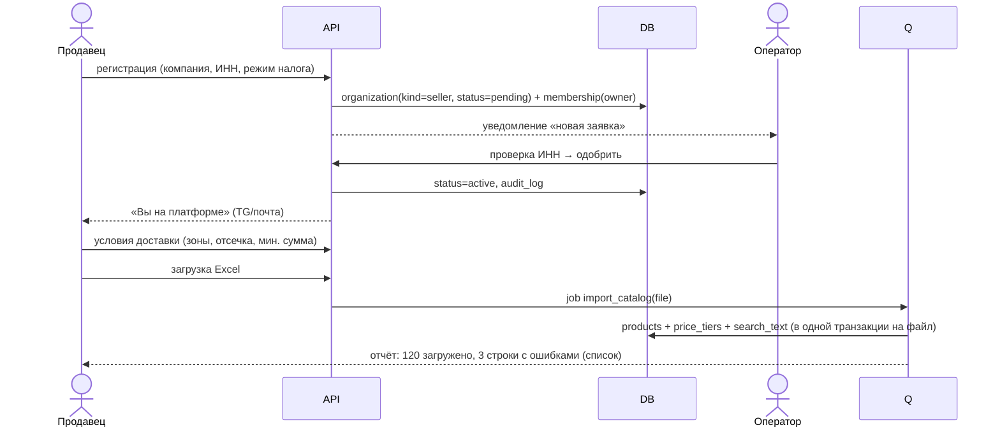
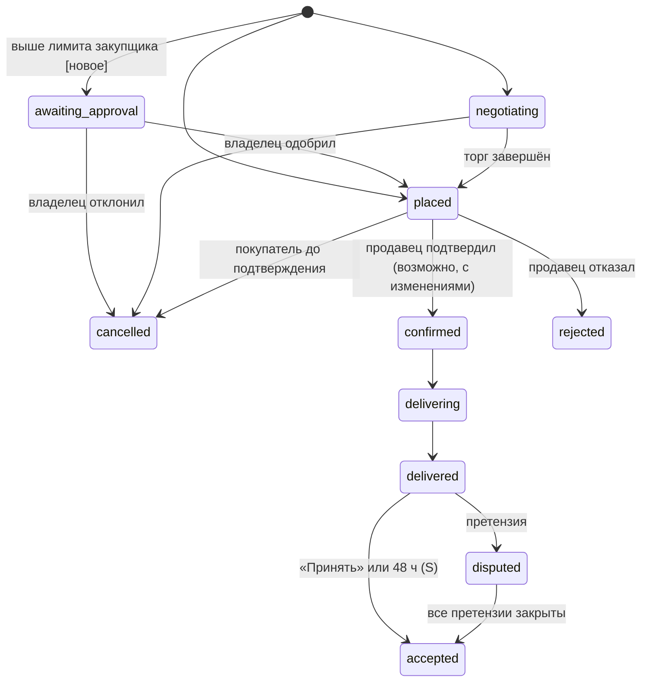
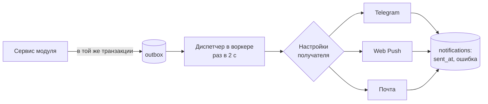
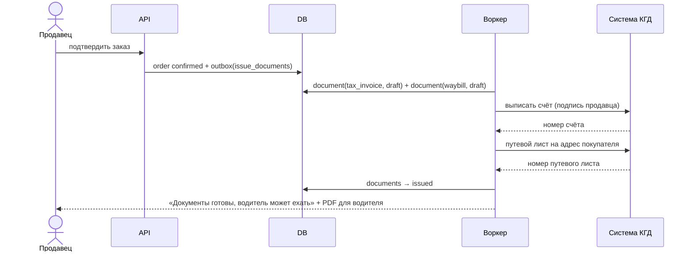
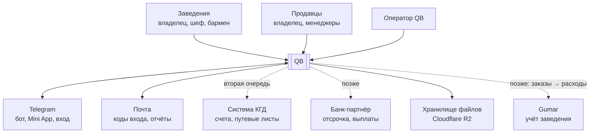
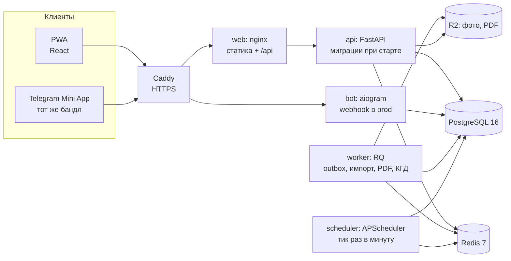
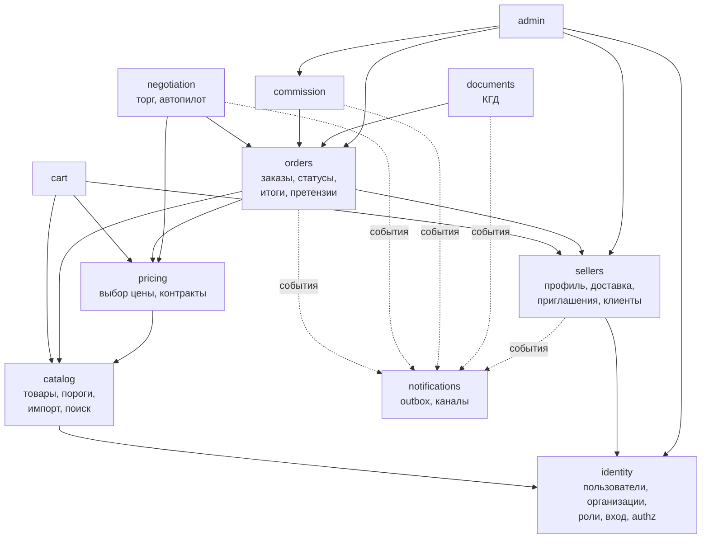

# QB — принципы, флоу и архитектура

> v0.1 · 22.10.2026 · продолжает [01-research-and-concept.md](01-research-and-concept.md) и [02-mvp.md](02-mvp.md)
> Всё, что здесь помечено **[новое]**, ещё не реализовано в коде и не входит в модель данных из 02-mvp.

Документ отвечает на три вопроса:
1. **Принципы** — по каким правилам принимаем продуктовые и технические решения.
2. **Флоу** — как идут главные сценарии от нажатия кнопки до записи в базе.
3. **Архитектура** — из каких частей состоит система, как они связаны и что где лежит.

---

## Часть 1. Принципы

### 1.1. Продуктовые

| # | Принцип | Что это значит на практике |
|---|---|---|
| P1 | **Быстрее звонка** | Повторный заказ — максимум 3 нажатия. Если сценарий дольше звонка поставщику, его упрощаем, а не объясняем |
| P2 | **Одна корзина** | Покупатель думает «что мне нужно», а не «у кого что». Разбиение по продавцам делает система |
| P3 | **Сначала инструмент продавца** | Продавец получает пользу даже без новых клиентов (приём заказов, документы). Своих клиентов он приводит сам — с ними 0% |
| P4 | **Торг ускоряет сделку** | Ограничения по раундам и срокам, автопилот, договорённая цена сразу становится заказом. Нет бесконечных чатов |
| P5 | **Честная автоматика** | Всё, что сделал автопилот или система, подписано в ленте («Автоответ продавца», «Принято автоматически через 48 ч») |
| P6 | **Цены конфиденциальны** | Договорённые и контрактные цены видят только две стороны сделки. Скрытые пороги автопилота не видит никто, кроме продавца |
| P7 | **Деньги и документы — точно** | Суммы никогда не «примерно». Каждое изменение суммы заказа объяснимо записью в журнале |
| P8 | **Три языка и Telegram по умолчанию** | Армянский, русский, английский — везде, включая каталог. Срочные действия (заказ, торг) доступны прямо из Telegram |
| P9 | **История не переписывается** | Прошлые заказы показывают те цены, названия и комиссию, что были на момент сделки |
| P10 | **Меньше полей — больше умолчаний** | Шеф на кухне не заполняет формы: адрес, дата доставки, способ оплаты подставляются из прошлого |

### 1.2. Инженерные

| # | Принцип | Как соблюдаем |
|---|---|---|
| E1 | **Модульный монолит** | Один процесс API, одна база. Границы между модулями — в коде (§3.3), а не в сети. Микросервисы — не раньше, чем появится реальная причина |
| E2 | **Скучные технологии, как в Gumar** | FastAPI, PostgreSQL, Redis + RQ, React. Новая технология — только через запись в §4 с причиной |
| E3 | **Правила — чистые функции** | Машины состояний, выбор цены, автопилот, расчёт комиссии — функции без базы и сети. Их проще всего тестировать (пример — `core/pricing.py`) |
| E4 | **Состояние меняет только сервис** | HTTP-обработчики и Telegram-бот не пишут в базу напрямую — они вызывают сервисы модулей. Один и тот же сервис используют веб, бот и планировщик |
| E5 | **Одна операция — одна транзакция** | Сервисный метод открывает транзакцию, блокирует нужные строки, проверяет правила, пишет изменения и событие. Всё или ничего |
| E6 | **Побочные эффекты — после коммита** | Уведомления, PDF, внешние API — через outbox и очередь (§3.6). Если Telegram недоступен, заказ всё равно создан |
| E7 | **Время и таймеры — на сервере** | Сроки ответа, автоприёмка, истечение контрактов считает сервер в UTC и показывает в часовом поясе Еревана (Asia/Yerevan) |
| E8 | **Повтор безопасен** | Отправка корзины и ответы на торг идемпотентны: двойное нажатие или повтор запроса не создаёт второй заказ |
| E9 | **Целые драмы и снимки** | `bigint` драмы, ставки в базисных пунктах, снимки цен и названий в строках заказа |
| E10 | **Внешние системы — за интерфейсом** | Налоговая (КГД), платежи, каналы уведомлений — через порт с заглушкой. Код модулей не знает, настоящая это интеграция или mock |
| E11 | **Изоляция организаций** | Каждый запрос работает в контексте одной организации. Каждый запрос к данным фильтруется по ней — это проверяют тесты |
| E12 | **Тесты на правила, а не на фреймворк** | Обязательно покрыты: машины состояний, торг, цены, комиссия, права доступа. UI — дымовыми тестами |

---

## Часть 2. Флоу

Обозначения в диаграммах: **API** — FastAPI, **DB** — PostgreSQL, **Q** — очередь RQ, **W** — воркер, **S** — планировщик, **TG** — Telegram.

### 2.1. Подключение продавца



Правила:
- Пока продавец `pending`, его каталог не виден покупателям, но он может его заполнять.
- Импорт идемпотентен по `(seller_id, sku)`: повторная загрузка обновляет цены, а не дублирует товары.
- Строки с ошибками не блокируют весь файл; продавец получает их список.

### 2.2. Покупатель приходит по приглашению продавца

```mermaid
sequenceDiagram
  actor Buyer as Заведение
  participant Web as PWA / Mini App
  participant API
  participant DB
  Buyer->>Web: открывает ссылку /join/LORI-ARAX
  Web->>API: GET /invites/LORI-ARAX (публично: имя продавца, логотип)
  Buyer->>Web: вход через Telegram, анкета заведения
  Web->>API: POST /organizations (buyer) + invite_code
  API->>DB: organization, membership(owner), address
  API->>DB: invite.used_by = org; client_link(source=seller_invited)
  API-->>Buyer: главная, продавец уже в «Моих поставщиках»
```

Правила:
- Код приглашения можно использовать много раз (один QR на кассе), но `client_link` создаётся только один раз на пару.
- Если пара уже существует с источником `platform`, приглашение источник **не меняет** — иначе продавцы переводили бы клиентов с платформы в 0% задним числом.
- Покупатель, пришедший сам, получает `client_link(source=platform)` при **первом заказе** у продавца.

### 2.3. Отправка корзины на нескольких продавцов

```mermaid
sequenceDiagram
  actor Chef as Закупщик
  participant API
  participant DB
  participant Q
  Chef->>API: POST /checkout (Idempotency-Key, address_id)
  API->>DB: BEGIN; lock cart_items покупателя
  API->>API: проверки: наличие, кратность, мин. партия, мин. сумма продавца, лимит закупщика
  alt есть ошибки
    API-->>Chef: 422 со списком проблем по строкам
  else всё в порядке
    API->>DB: checkout + order на каждого продавца + order_lines (снимки, цены через pricing)
    API->>DB: negotiation для заказов с предложениями цены
    API->>DB: order_events + outbox; очистить корзину; COMMIT
    API-->>Chef: 201: список заказов и их статусы
    DB-->>Q: outbox → уведомления продавцам
  end
```

Правила:
- **Всё или ничего:** если хоть один продавец не проходит проверку, не создаётся ни один заказ. Покупатель видит, что поправить.
- **Идемпотентность:** повтор с тем же `Idempotency-Key` в течение 24 ч возвращает тот же результат **[новое: таблица `idempotency_keys`]**.
- **Лимит закупщика:** если сумма выше `order_limit_amd`, заказ получает статус `awaiting_approval`, и владелец подтверждает его в Telegram **[новое: статус и флоу]**.
- **Дата доставки** = ближайший день доставки продавца в районе адреса с учётом времени отсечки.
- Строки без предложения цены получают итоговую цену сразу; строки с предложением — `final_price_amd = null`.

### 2.4. Торг с автопилотом

```mermaid
sequenceDiagram
  actor Buyer as Покупатель
  participant API
  participant Neg as negotiation.service
  participant Auto as autopilot (чистая функция)
  participant DB
  actor Seller as Продавец
  Buyer->>API: предложение 3 100 ֏/кг (в составе checkout)
  API->>Neg: open(order, offer)
  Neg->>DB: SELECT order, negotiation FOR UPDATE
  Neg->>Auto: decide(offer, rule, list_price, client_stats)
  alt автопилот отвечает
    Auto-->>Neg: counter(3 300)
    Neg->>DB: offer(seller, is_auto) + status=awaiting_buyer + expires_at
    Neg-->>Buyer: «Автоответ продавца: 3 300 ֏»
  else правила нет
    Auto-->>Neg: manual
    Neg->>DB: status=awaiting_seller + expires_at
    Neg-->>Seller: TG: [Принять] [Встречная] [Отклонить]
  end
  Buyer->>API: принять 3 300
  API->>Neg: respond(accept)
  Neg->>DB: lock; final_price = 3 300 (negotiated); пересчёт итогов
  Neg->>DB: status=agreed; order → placed; события
  Neg-->>Seller: «Заказ по 3 300 ֏ — подтвердите»
```

Решение автопилота (`domain/negotiation/autopilot.py`, чистая функция):

```
вход: предложенная цена P, цена каталога L, правило R, статистика клиента C, количество Q
1. R нет или выключено                          → manual
2. R.only_regulars и C.orders_count < 3          → manual
3. R.min_qty задан и Q < R.min_qty               → manual
4. сумма строки < R.min_line_amd                 → decline("торг от N ֏")
5. floor  = R.floor_price_amd  или L × R.floor_pct
   accept = R.auto_accept_price_amd или L × R.auto_accept_pct
6. P ≥ accept                                    → accept(P)
7. P < floor                                     → decline
8. R.auto_counter                                → counter(max(accept, округл((P + L) / 2, до 10 ֏)))
9. иначе                                         → manual
```

Правила переговоров (из 02-mvp §6.2) проверяются в сервисе **до** вызова автопилота: число раундов, срок, «не ниже 50%», «встречная не выше цены каталога», чей сейчас ход.

Конкурентность: ответ человека и автопилота или истечение срока могут прийти одновременно. Все три пути берут `SELECT … FOR UPDATE` на строку `negotiations` и проверяют, что статус и `round` не изменились. Проигравший получает `409 Conflict` с актуальным состоянием.

### 2.5. Исполнение заказа



Правила:
- Переходы описаны одной таблицей в `domain/orders/state.py`: `(статус, действие, роль) → новый статус`. Любой переход не из таблицы — ошибка `409`.
- **Подтверждение с изменениями.** Продавец может уменьшить количество (`qty_confirmed`) или убрать строку, но не поднять цену. Если итог уменьшился больше чем на 20%, покупатель получает уведомление и может отменить заказ в течение 2 часов **[новое]**.
- **Приёмка.** Покупатель вводит `qty_received`; расхождение с `qty_confirmed` автоматически предлагает открыть претензию.
- **Итоги** пересчитываются одной функцией `domain/orders/totals.py` после каждого изменения строк, скидки или претензии.

### 2.6. Претензия

```mermaid
sequenceDiagram
  actor Buyer as Покупатель
  participant API
  actor Seller as Продавец
  actor Op as Оператор
  Buyer->>API: претензия: недовес 2 кг сыра + фото
  API-->>Seller: TG: претензия [Принять] [Оспорить]
  alt продавец принимает
    Seller->>API: принять
    API->>API: resolution_amd = 2 × цена; пересчёт заказа
  else оспаривает
    Seller->>API: оспорить + комментарий
    API-->>Op: спор в админке
    Op->>API: решение (сумма корректировки)
  end
  API-->>Buyer: заказ скорректирован, статус accepted
```

Если продавец не ответил на претензию за 72 часа, она уходит оператору.

### 2.7. Комиссия

1. **При переходе заказа в `accepted`** сервис `commission` считает ставку:
   `ставка = правило(категория, источник клиента) + надбавка за первый заказ (если это первый заказ пары с источником platform)`.
   Для заказа с несколькими категориями считается по строкам, в заказ пишутся итоговые `commission_amd` и средневзвешенная `commission_rate_bp`.
2. Комиссия считается от суммы строк **после** претензий и **без** доставки.
3. **1-го числа** планировщик закрывает прошлый месяц: `commission_statements` по каждому продавцу → PDF → уведомление.
4. Претензия, закрытая после закрытия месяца, попадает корректировкой в следующий месяц, а не меняет выставленный счёт.

### 2.8. Контрактная цена

- После `agreed` по строке продавцу предлагается «Закрепить цену на 30 дней?» → `price_agreements`.
- Планировщик ежедневно в 09:00 по Еревану: за 3 дня до `valid_until` — напоминание обеим сторонам; после `valid_until` — `status = expired`.
- Новая контрактная цена на тот же товар для той же пары закрывает старую (`cancelled`), а не создаёт вторую активную.

### 2.9. Уведомления



- Получатели — все сотрудники организации с подходящей ролью (заказ продавцу → владелец и менеджеры).
- Ключ дедупликации `(событие, получатель)`: повтор не шлёт второе сообщение.
- Срочные (новый заказ, предложение цены, претензия) — сразу; несрочные (напоминания) — с 09:00 до 21:00 по Еревану.
- Кнопки в Telegram несут подписанный `callback_data` (тип, id, действие); бот вызывает тот же сервис, что и веб.

### 2.10. Документы КГД (вторая очередь)



По HO-309-N документы должны быть **до** отгрузки, поэтому статус `delivering` недоступен, пока документы не `issued` (если у продавца включена интеграция). Ошибка КГД → `failed`, продавцу кнопка «Повторить» и инструкция на случай сбоя системы (бумажный документ + синхронизация в 2 рабочих дня).

### 2.11. Права доступа

| Действие | Владелец заведения | Закупщик | Владелец продавца | Менеджер продавца | Оператор |
|---|---|---|---|---|---|
| Смотреть каталог | ✓ | ✓ | ✓ | ✓ | ✓ |
| Собрать корзину | ✓ | ✓ | — | — | — |
| Отправить заказ | ✓ | ✓ до лимита | — | — | — |
| Предложить цену | ✓ | если `can_negotiate` | — | — | — |
| Ответить на торг, подтвердить заказ | — | — | ✓ | ✓ | — |
| Каталог, цены, правила автопилота | — | — | ✓ | ✓ (без правил автопилота) | — |
| Сотрудники организации | ✓ | — | ✓ | — | — |
| Отчёт по комиссии | — | — | ✓ | — | ✓ |
| Модерация, споры, вход «от имени» | — | — | — | — | ✓ (с записью в audit_log) |

Проверка — одна функция `authz.require(user, org, action)` с этой таблицей в коде; тест проходит по каждой ячейке.

---

## Часть 3. Архитектура

### 3.1. Контекст (кто вокруг системы)



### 3.2. Контейнеры (что запущено)



Все контейнеры (кроме nginx) — один и тот же образ бэкенда с разной командой запуска. Это уже так в [docker-compose.yml](../docker-compose.yml).

### 3.3. Модули и зависимости



Правила зависимостей:
- Стрелки — единственные разрешённые импорты сервисов. **Обратных нет:** `orders` не знает про `negotiation`; когда торг завершён, `negotiation` вызывает `orders.service.apply_negotiated_prices(...)`.
- Все модули могут импортировать `identity` (контекст пользователя) и **модели** любого модуля для чтения в запросах. Писать в таблицы чужого модуля — только через его сервис.
- `notifications` никто не вызывает напрямую: модули пишут событие в outbox.
- Проверка — тест, который разбирает импорты (`import-linter` или свой скрипт) **[новое]**.

### 3.4. Слои внутри модуля и структура кода

Целевая структура (каркас пока лежит плоско: `models/`, `api/`, `core/`; переносим по мере появления логики, без «большого переезда»):

```
backend/app/
├── models/                 # SQLAlchemy-модели всех модулей (одна metadata для Alembic) — уже так
├── platform/               # общее: db, config, outbox, idempotency, errors, clock, i18n, authz
├── domain/                 # чистые функции: ничего не знают о базе и HTTP
│   ├── pricing.py          # (сейчас core/pricing.py)
│   ├── orders/state.py     # таблица переходов статусов
│   ├── orders/totals.py    # пересчёт сумм
│   ├── negotiation/rules.py
│   ├── negotiation/autopilot.py
│   └── commission.py
├── services/               # транзакции: блокировки, проверки, запись, события
│   ├── checkout.py
│   ├── orders.py
│   ├── negotiation.py
│   └── ...
├── api/                    # HTTP: схемы, авторизация, вызов сервиса — без бизнес-логики
├── bot/                    # Telegram: те же сервисы, что и api
├── workers/                # задачи RQ: outbox-диспетчер, импорт, PDF, КГД
├── integrations/           # порты и адаптеры: src_einvoice (mock|real), notifier (telegram|push|email), storage
└── scheduler.py            # только находит «что пора» и вызывает сервисы
```

| Слой | Можно | Нельзя |
|---|---|---|
| `api`, `bot` | Проверить токен и права, разобрать вход, вызвать сервис, вернуть схему | SQL-запросы на запись, бизнес-правила |
| `services` | Транзакции, блокировки, вызов domain, запись моделей, событие в outbox | HTTP-исключения FastAPI, вызовы внешних API |
| `domain` | Чистые функции и dataclass | Импорт SQLAlchemy, FastAPI, Redis, `datetime.now()` (время передаётся параметром) |
| `integrations` | Вызовы внешних систем за интерфейсом | Доступ к базе (кроме своей таблицы логов) |
| `workers`, `scheduler` | Найти работу, вызвать сервис или интеграцию | Собственные бизнес-правила |

Ошибки: сервисы бросают доменные исключения (`NotAllowed`, `Conflict`, `ValidationFailed(problems)`), один обработчик в `api` превращает их в HTTP 403/409/422.

### 3.5. Транзакции и конкурентность

- Сессия на запрос. **Транзакцией владеет вызывающий** (обработчик API, бот, задание планировщика): сервисы только читают, блокируют и пишут, а `commit` делает вызывающий. Так ответ с защитой от повтора (`idempotency_keys`) сохраняется в той же транзакции, что и сам заказ.
- **Порядок блокировок** всегда один: `orders` → `negotiations` → `order_lines`. Так исключаем взаимные блокировки.
- Блокируем строку того объекта, состояние которого меняем (`SELECT … FOR UPDATE`), и сверяем ожидаемое состояние (статус, раунд). Несовпадение → `Conflict` с актуальным объектом.
- Корзину блокируем при отправке, чтобы два сотрудника одного кафе не отправили её дважды.
- Изоляция `READ COMMITTED` (по умолчанию в PostgreSQL) + явные блокировки. `SERIALIZABLE` не нужен.

### 3.6. События: журнал и outbox

Два разных механизма:

| | `order_events` (уже есть) | `outbox` **[новое]** |
|---|---|---|
| Зачем | История для людей и аналитики | Доставка побочных эффектов |
| Пишется | В той же транзакции, что и изменение | В той же транзакции, что и изменение |
| Живёт | Навсегда | Удаляется через 7 дней после обработки |
| Читает | UI, отчёты, аналитика | Диспетчер в воркере |

`outbox`: `id, topic (order.placed, offer.received, …), payload, created_at, processed_at, attempts, last_error`.
Диспетчер (в MVP — задание планировщика, раз в 2 секунды) забирает пачку `FOR UPDATE SKIP LOCKED`, вызывает обработчик темы и отмечает `processed_at`. Пока канал уведомлений не выбран, обработчик только пишет в лог (`workers/outbox.py`). Задача должна быть идемпотентной (ключ дедупликации в `notifications`). Повторы — с нарастающей паузой, после 10 попыток — алерт оператору.

### 3.7. Планировщик

Каждое задание — «найти просроченное и вызвать сервис», идемпотентно, безопасно при повторе:

| Задание | Когда | Что ищет |
|---|---|---|
| `expire_negotiations` | каждую минуту | `negotiations` в `awaiting_*` с `expires_at < now` |
| `auto_accept_deliveries` | каждую минуту | `orders` в `delivered` дольше 48 ч без претензий |
| `escalate_claims` | каждый час | претензии `open` дольше 72 ч |
| `expire_agreements` | 09:00 Ереван | контракты, которые заканчиваются через 3 дня или уже закончились |
| `close_commission_month` | 1-е число, 06:00 Ереван | заказы `accepted` за прошлый месяц |
| `dispatch_outbox` | в планировщике, каждые 2 с | необработанные записи outbox |

Запускается один экземпляр планировщика (контейнер `scheduler`). Если их когда-то станет несколько — блокировка `pg_try_advisory_lock` на задание.

### 3.8. Доступ и контекст организации

- **Вход:** Telegram (Login Widget и initData Mini App) и код на почту; в разработке — `DEV_LOGIN`. Результат — JWT на 30 дней (как в Gumar).
- **Контекст организации:** заголовок `X-Org-Id` в каждом запросе (PWA запоминает выбранную организацию). Сервер проверяет, что пользователь в ней состоит, и передаёт в сервисы объект `Actor(user, org, role)` **[новое]**.
- **Изоляция:** любой запрос покупателя фильтруется по `buyer_id = actor.org`, продавца — по `seller_id = actor.org`. Каталог — исключение (публичен для всех вошедших), но договорённые цены подмешиваются только для своей организации.
- **Оператор** видит всё; вход «от имени» пишет в `audit_log` поле `impersonated_by`.

### 3.9. Правила API

- REST + JSON. Деньги — целые числа (`*_amd`), количество — строки-десятичные (`"0.500"`), время — ISO 8601 в UTC, id — UUID.
- Ошибки — единый формат: `{"code": "min_order_not_reached", "message": "...", "details": {...}}`. `message` — на языке из `Accept-Language`; клиент может показывать свой текст по `code`.
- Списки: `limit` / `offset` + `total`. Для лент событий — курсор по `id` (UUID v7 сортируется по времени).
- Изменяющие операции, которые нельзя повторять (`/checkout`, ответы на торг), принимают `Idempotency-Key`.
- Версии API в пути не вводим, пока единственный клиент — наш PWA. Появится мобильное приложение — `/v1`.
- Документация — автоматическая OpenAPI (`/docs`); типы для фронта генерируются из неё **[новое: openapi-typescript]**.

### 3.10. Данные

- **Владение:** каждая таблица принадлежит одному модулю (см. 02-mvp §7.2); писать в неё может только его сервис.
- **Удаление:** товары, организации и пользователи не удаляются физически — статус или `archived_at` **[новое для товаров]**, чтобы не ломать историю заказов.
- **Снимки:** строки заказа хранят название, единицу и цены; заказ — источник клиента и ставку комиссии.
- **Миграции:** только через Alembic, применяются при старте `api`. Разрушающие изменения — в два шага (добавить новое → перенести данные → удалить старое в следующем релизе).
- **Поиск:** `pg_trgm` по `search_text` (три языка + транслитерация). Если товаров станет больше ~500 тыс. или понадобятся синонимы и опечатки — Meilisearch.
- **Файлы:** фото и PDF в R2 (S3-API), в базе только ключ. Фото сжимаются на клиенте до 1600 px.

### 3.11. Языки и время

- Тексты каталога — `jsonb {"hy","ru","en"}`; тексты интерфейса — словарь в PWA (`web/src/i18n.ts`) и в боте.
- Язык пользователя — `users.locale`; уведомления уходят на языке получателя, а не отправителя.
- В базе всё в UTC; дни доставки, отсечка и «рабочие часы» уведомлений — в Asia/Yerevan.

### 3.12. Безопасность и приватность

- HTTPS через Caddy; секреты только в `.env` на сервере; `DEV_LOGIN` запрещён в prod (проверка в `config.py` уже есть).
- Ограничение частоты: вход — 10/мин с IP; предложения цены — по правилам торга; остальное API — 120/мин на пользователя (Redis) **[новое]**.
- Персональные данные минимальны: имя, Telegram id, почта, телефон по желанию. Удаление аккаунта — обезличивание пользователя с сохранением заказов организации.
- Бэкапы: ночной `pg_dump` + файлы в R2, хранение 30 дней, восстановление проверяется раз в месяц (как в Gumar).

### 3.13. Наблюдаемость

- Логи в JSON с `request_id`, `user_id`, `org_id`; без цен и персональных данных в тексте.
- Ошибки — self-hosted GlitchTip (совместим с Sentry SDK) **[новое]**.
- Продуктовые метрики из `order_events` и `offers` простыми SQL-представлениями: заказы в день, доля заказов с торгом, конверсия торга, время ответа продавца, повторные заказы. Смотреть — Metabase позже, сначала SQL в админке.
- Здоровье: `/health` (процесс жив) и `/ready` (база и Redis доступны) **[новое]**.

### 3.14. Развёртывание

| Среда | Где | Как |
|---|---|---|
| dev | Mac, Colima | `docker compose up -d`, демо-данные, `DEV_LOGIN=true` |
| prod | Один VPS (как Gumar: Contabo) | `docker-compose.prod.yml`: Caddy, без внешних портов у базы и Redis, лимиты памяти, webhook бота, бэкапы |

Выкатка: `git pull` → `docker compose build` → `up -d` (миграции при старте `api`). Простой в несколько секунд в MVP допустим; выкатываем ночью по Еревану.

### 3.15. Когда что менять (путь роста)

| Сигнал | Решение |
|---|---|
| API стабильно > 70% CPU | Несколько реплик `api` за Caddy (состояния в процессе нет) |
| Медленный поиск, нужны опечатки и синонимы | Meilisearch, индексирование из outbox |
| Очередь копится | Больше воркеров RQ; тяжёлые задачи (импорт, PDF) — в отдельную очередь |
| База > 50 ГБ или медленные отчёты | Реплика для чтения, отчёты и аналитика — с неё |
| Вторая страна (Грузия) | `country`, валюта и налоговые правила в организации; интеграция документов — второй адаптер того же порта |
| Нативное приложение | `/v1` в API, push через FCM/APNs вторым каналом notifier |

### 3.16. Тестирование

| Уровень | Что | Инструмент |
|---|---|---|
| Домен | Машины состояний (каждый разрешённый и запрещённый переход), автопилот (таблица случаев), цены, итоги, комиссия | pytest, без базы |
| Сервисы | Транзакции, блокировки, конфликты (два одновременных ответа на торг), идемпотентность checkout, изоляция организаций | pytest + `qb_test` |
| API | Права по таблице §2.11, формат ошибок | pytest + httpx |
| Фронт | Форматирование, ключевые экраны | vitest + Testing Library |
| Сквозные | Заказ с торгом от корзины до приёмки в браузере | Playwright, перед релизом **[новое]** |

---

## Часть 4. Решения

| # | Решение | Почему | Цена решения |
|---|---|---|---|
| D1 | Модульный монолит | Команда 1–2 человека, одна база проще в транзакциях | Нужна дисциплина границ модулей (§3.3) |
| D2 | Стек Gumar | Переиспользуем код, деплой, опыт и армянское распознавание речи | Python медленнее Go/Node на CPU — для нашей нагрузки неважно |
| D3 | Торг привязан к заказу | Договорились — заказ уже создан; нет второй корзины | Заказ может долго висеть в `negotiating` — лечится сроками |
| D4 | Outbox вместо прямых вызовов | Заказ не теряется из-за сбоя Telegram; повторы безопасны | Задержка уведомлений до ~2 с |
| D5 | Целые драмы, ставки в bp | Никаких ошибок округления | Если появятся валюты с копейками — новая колонка `currency` и минорные единицы |
| D6 | Цена = торг, иначе минимум из каталога, порога и контракта | Контракт не должен наказывать постоянного клиента | Продавцу нужно понимать, что объёмная скидка может быть ниже контракта |
| D7 | `pg_trgm` вместо поискового движка | Нет нового сервиса; армянский без словаря работает | Нет синонимов и морфологии |
| D8 | Оплата вне платформы в MVP | Нет лицензии и банка-партнёра; проверяем спрос | Комиссию собираем счётом раз в месяц — риск неоплаты продавцом |
| D9 | Заголовок `X-Org-Id` | Один человек может работать в нескольких организациях | Клиент обязан его передавать; ошибка → 403 |
| D10 | Мягкое удаление | История заказов не ломается | Нужно фильтровать архивные записи |

## Часть 5. Что добавить в модель данных (миграция 0002)

> Сделано в `0002`: `outbox`, `idempotency_keys`, `products.archived_at`, `notifications.dedupe_key`, а также `cart_items.offer_price_amd` и `orders.cancel_reason`. Статус `awaiting_approval` и `notification_prefs` пока не сделаны: сотруднику сверх лимита checkout отвечает ошибкой `over_staff_limit`.

| Что | Зачем |
|---|---|
| `outbox` | Доставка уведомлений и задач после коммита (§3.6) |
| `idempotency_keys(key, actor, response, created_at)` | Повтор checkout и ответов на торг (§2.3) |
| `OrderStatus.awaiting_approval` | Заказ выше лимита закупщика ждёт владельца (§2.3) |
| `products.archived_at` | Мягкое удаление товаров (§3.10) |
| `notification_prefs(user_id, channel, topic, enabled)` | Настройки каналов уведомлений (§2.9) |
| `notifications.dedupe_key` (уникальный) | Защита от двойной отправки (§2.9) |

## Открытые вопросы

1. Кто одобряет заказ сверх лимита закупщика, если владелец не отвечает: срок и что потом (отмена или автоодобрение)?
2. Нужно ли продавцу подтверждать заказ, если он целиком по контрактным ценам и в наличии, или такой заказ подтверждать автоматически?
3. Хранить ли фото претензий дольше 90 дней?
4. Нужна ли отдельная роль «бухгалтер» у заведения и продавца (видит документы и отчёты, не делает заказы)?
5. Вход по почте: нужен ли он с первого дня, или достаточно Telegram?
