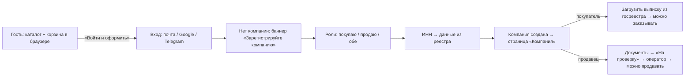

# QB — вход, гостевой режим, личные кабинеты, две роли

> v0.1 · 22.10.2026 · дополняет [03-architecture.md](03-architecture.md) и [04-documents-and-verification.md](04-documents-and-verification.md)

## 1. Кто что видит и может

| Кто | Видит | Может | Не может |
|---|---|---|---|
| **Гость** (не вошёл) | Каталог: товары, цены, объёмные скидки, «можно торговаться». **Продавец скрыт** («виден после входа») | Искать, фильтровать, собирать корзину (хранится в браузере) | Оформить заказ, торговаться, писать продавцу, отправлять запрос |
| **Вошёл, компании нет** | То же + имена продавцов | Собирать корзину, зарегистрировать компанию | Всё, что выше, пока нет компании |
| **Компания-покупатель** | Каталог, корзина, заказы, компания | Корзина на сервере, торг, заказ — **после загрузки выписки из госреестра** (проверка оператором не ждётся) | — |
| **Компания-продавец** | Входящие, заказы, свои товары, условия доставки, компания | Заводить товары, условия доставки, автопилот торга — **сразу**. Принимать заказы и заключать договорённости — **после проверки оператором**; до неё товары не видны в каталоге | — |
| **Оператор QB** | Очередь модерации | Проверять документы, подтверждать или отклонять компанию | — |

Одна компания может и покупать, и продавать: флаги `is_buyer` и `is_seller` вместо одного `kind`.
Сторона, от которой действует пользователь, — **режим** (`X-Mode: buyer|seller`), переключатель «Покупаю / Продаю»
на главном экране (на телефоне — в шапке, на компьютере — в боковой панели). Режим запоминается для каждой компании.

## 2. Вход

Три способа, один аккаунт: личность (`user_identities`) привязывается к пользователю по провайдеру,
а если её ещё нет — по совпадающей почте.

| Способ | Как работает | Что нужно для запуска |
|---|---|---|
| **Код на почту** | 6 цифр, живёт 10 минут, 5 попыток, не больше 5 кодов в час на адрес; в базе только хэш | `MAIL_PROVIDER=resend`, `RESEND_API_KEY`, `MAIL_FROM` на подтверждённом домене. В разработке (`console`) код пишется в лог api и показывается на экране при `DEV_LOGIN=true` |
| **Google** | Кнопка Google Identity Services → ID-токен → проверка подписи и `aud` на сервере | `GOOGLE_CLIENT_ID` (OAuth Web client), адрес сайта в Authorized JavaScript origins |
| **Telegram** | Login Widget → подписанные данные → проверка HMAC токеном бота, не старше суток | `TELEGRAM_BOT_TOKEN`, `TELEGRAM_BOT_USERNAME`, домен сайта в @BotFather (`/setdomain`) |

Кнопки Google и Telegram появляются сами, когда заданы ключи (`GET /api/config`).

## 3. Путь нового пользователя

Гостевая корзина переносится на сервер при первом входе в режиме покупателя (позиции, которые нельзя купить —
свои товары или пропавшие, — пропускаются).

## 4. Кабинеты

**Покупатель:** Каталог (быстрый повтор заказов) · Корзина (по продавцам, торг, скидка на заказ) · Заказы · Компания.
**Продавец:** Входящие (что ждёт ответа) · Заказы · Товары (названия на трёх языках, цена, мин. партия и шаг,
объёмные пороги, «можно торговаться» + автопилот: ниже — отказ, от — принять, между — встречная цена; архив) ·
Доставка (минимальный заказ, приём до, срок, стоимость, бесплатно от, ответ на торг, районы × дни недели) · Компания
(реквизиты, документы, роли: «Начать продавать» / «Начать покупать»).

Вёрстка: телефон — шапка + плавающая панель вкладок; от 1024 px — боковая панель с навигацией, переключателем
режима, языком и выходом; окна редактирования — снизу на телефоне и по центру на компьютере.

## 5. API этого этапа

| Метод | Путь | Кто |
|---|---|---|
| POST | `/auth/email/start`, `/auth/email/verify` | все |
| POST | `/auth/google`, `/auth/telegram` | все |
| GET | `/products`, `/categories` | все; гостю `seller = null`, `guest = true` |
| POST | `/organizations/me/roles` | владелец |
| GET/POST/PUT | `/seller/products[/{id}[/archive\|/restore]]` | продавец (owner, manager) |
| GET/PUT | `/seller/settings` | продавец |

## 6. Что ещё не сделано (предлагаемый порядок)

1. ~~Чат по заказу~~ (сделан). Осталось: **запрос (RFQ)** «нужно 50 кг сыра к пятнице» нескольким продавцам
   с ответами-предложениями.
2. **Команда.** Приглашение сотрудников по почте с ролью; запрос на вступление в уже зарегистрированную компанию
   (сейчас второй человек с тем же ИНН получает «уже в QB» и упирается в стену).
3. ~~Уведомления~~ (сделаны: колокольчик, почта, Telegram). Осталось: web push на телефон, дайджест вместо писем
   на каждое событие.
4. **Претензии при приёмке**: недовес, брак, фото, частичный возврат с корректировкой документов.
5. **Оплата и биллинг**: счёт на оплату, отметка об оплате, отсрочка, комиссия QB по закрытым заказам.
6. **Фото товаров и импорт прайса из Excel** — без этого продавцу с 300 позициями не завести каталог.
7. **Рейтинги и отзывы** после приёмки; публичная страница продавца (SEO, ссылка для своих клиентов).
8. **Избранное и шаблоны заказов**, несколько точек доставки у одной сети.
9. **Отчёты**: закупки по продавцам и категориям для покупателя, продажи и средняя скидка торга для продавца.
10. **Юридическое**: оферта и правила площадки с галочкой при регистрации, политика данных, удаление аккаунта.
11. **Безопасность аккаунта**: список сессий, выход везде, привязка второго способа входа на странице профиля.
12. **Кабинет оператора**: поиск компаний, блокировка, споры, ручная корректировка заказа, журнал действий.

## 7. Уведомления, чат, документы (22.10.2026)

| Что | Как |
|---|---|
| Колокольчик | все события заказа другой стороны: новый заказ, встречная цена, подтверждение, в пути, доставлен, принят, оплачен, сообщение в чате |
| Почта | копия каждого уведомления, можно выключить в «Уведомления → Куда присылать» |
| Telegram | «Привязать Telegram» → бот → Start; нужен `TELEGRAM_BOT_TOKEN` и `TELEGRAM_BOT_USERNAME` |
| Чат | внутри заказа, видят только покупатель и продавец; открытие чата гасит его уведомления |
| Документы | раздел со всеми счетами, накладными, актами и номерами КГД: фильтр по виду, периоду, поиску; печать выбранных одной пачкой (`/print/batch`) |
