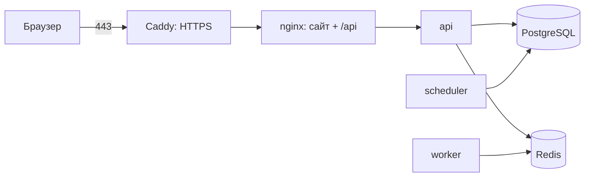

# QB — бесплатный хостинг на Oracle Cloud (Always Free)

> v0.1 · 22.10.2026 · одна виртуальная машина, всё в Docker Compose, HTTPS автоматически
> ⚠️ Лимиты Always Free Oracle менял в 2026 году (по обзорам, ARM-машина — до 2 ядер и 12 ГБ). Перед регистрацией
> сверить с [официальной страницей](https://docs.oracle.com/en-us/iaas/Content/FreeTier/freetier_topic-Always_Free_Resources.htm).



Наружу открыты только порты 80 и 443. База, Redis и API снаружи недоступны.

## 1. Аккаунт Oracle и машина

1. Зарегистрируйтесь на [oracle.com/cloud/free](https://www.oracle.com/cloud/free/). Нужна банковская карта для проверки;
   **домашний регион выбрать нельзя будет поменять** — берите Frankfurt (`eu-frankfurt-1`).
2. **Compute → Instances → Create instance:**
   - Image: **Ubuntu 24.04** (Canonical Ubuntu, версия для aarch64);
   - Shape: **VM.Standard.A1.Flex**, 2 OCPU, 12 ГБ (в пределах бесплатного);
   - Networking: публичный IPv4 включён;
   - SSH keys: *Generate a key pair* и скачайте приватный ключ (файл `.key`), либо вставьте свой `~/.ssh/id_ed25519.pub`;
   - Boot volume: 100 ГБ.
3. Если пишет `Out of capacity` — попробуйте позже или другой Availability Domain, это известная проблема ARM-машин.
4. **Сеть:** VCN машины → Security List → *Add Ingress Rules*: источник `0.0.0.0/0`, TCP, порты `80` и `443`.
5. **Чтобы машину не забрали за простой:** Oracle может остановить бесплатную машину, которая неделю почти не работает
   (CPU < 20%). Выход — *Billing → Upgrade to Pay As You Go*: бесплатные лимиты остаются, но машину больше не
   отбирают. Сразу поставьте *Budgets* с оповещением на $1.

## 2. Адрес (бесплатно)

Сайт на https нужно имя. Бесплатно: [duckdns.org](https://www.duckdns.org) → войти → создать `qbarmenia` →
в поле *current ip* вписать публичный IP машины. Получится `qbarmenia.duckdns.org`. Свой домен тоже подойдёт:
запись `A` на тот же IP.

## 3. Установка на машине

```bash
ssh -i ~/Downloads/ssh-key.key ubuntu@<публичный-IP>

# Docker
curl -fsSL https://get.docker.com | sudo sh
sudo usermod -aG docker ubuntu && exit        # зайти снова

# Файрвол Ubuntu от Oracle режет всё, кроме SSH — открыть 80 и 443
sudo iptables -I INPUT 5 -p tcp --dport 80 -j ACCEPT
sudo iptables -I INPUT 6 -p tcp --dport 443 -j ACCEPT
sudo apt-get install -y iptables-persistent && sudo netfilter-persistent save

git clone https://github.com/RAZ-AR/quick_bue.git qb && cd qb
cp .env.prod.example .env
sed -i "s|^JWT_SECRET=.*|JWT_SECRET=$(openssl rand -hex 32)|;s|^POSTGRES_PASSWORD=.*|POSTGRES_PASSWORD=$(openssl rand -hex 24)|" .env
nano .env        # DOMAIN, WEB_APP_URL, CORS_ORIGINS, MAIL_*, GOOGLE_CLIENT_ID …
```

Если репозиторий приватный — клонируйте по SSH (`git@github.com:RAZ-AR/quick_bue.git`) с ключом, добавленным в GitHub
(*Settings → Deploy keys*, достаточно read-only).

## 4. Запуск

```bash
docker compose -f docker-compose.prod.yml up -d --build   # 5–10 минут на первую сборку
docker compose -f docker-compose.prod.yml run --rm api python -m app.bootstrap you@example.com
```

`bootstrap` создаёт категории товаров и делает ваш адрес оператором. Демо-данные (`app.seed`) на сервер **не ставим**.
Откройте `https://<ваш-адрес>`, войдите по коду на почту — вы увидите очередь модерации.

Сертификат Let's Encrypt Caddy выпускает сам при первом обращении (нужно, чтобы DNS уже указывал на машину).

## 5. Ключи входа

| Что | Где взять | В `.env` |
|---|---|---|
| Письма с кодами | [resend.com](https://resend.com): API key; без своего домена писать можно только на свой адрес — для всех нужно подтвердить домен | `RESEND_API_KEY`, `MAIL_FROM` |
| Google | Google Cloud Console → Credentials → OAuth client ID (Web); Authorized JavaScript origins = `https://<адрес>` | `GOOGLE_CLIENT_ID` |
| Telegram | @BotFather → новый бот → токен; `/setdomain` → `<адрес>` | `TELEGRAM_BOT_TOKEN`, `TELEGRAM_BOT_USERNAME` |

После правки `.env`: `docker compose -f docker-compose.prod.yml up -d`. С Telegram запускайте и бота (уведомления и
привязка чата): `docker compose -f docker-compose.prod.yml --profile bot up -d`.

## 6. Обновление, логи, резервные копии

```bash
git pull && docker compose -f docker-compose.prod.yml up -d --build      # миграции применяются сами
docker compose -f docker-compose.prod.yml logs -f api                    # логи
docker compose -f docker-compose.prod.yml ps                             # состояние
```

**Резервные копии.** Ежедневно, 14 дней хранения (база + загруженные документы):
`crontab -e` → `0 3 * * * cd ~/qb && ./deploy/backup.sh`. Раз в неделю скачивайте копии к себе:
`scp -i <ключ> "ubuntu@<IP>:qb-backups/*" ~/qb-backups/` — копии на той же машине не спасут, если её потеряете.

Восстановление базы: `gunzip -c db-<дата>.sql.gz | docker compose -f docker-compose.prod.yml exec -T db psql -U qb qb`.

## 7. Что проверить перед первыми пользователями

- [ ] `https://<адрес>/api/config` отвечает, `dev_login` = `false`.
- [ ] Вход по коду на почту работает с чужим адресом (не только вашим).
- [ ] `REGISTRY_PROVIDER=eregister` (или `none`), но не `demo`: иначе вымышленные «компании» попадут в настоящую систему.
- [ ] Страница «Компания» принимает загрузку файла; файл переживает `docker compose … up -d --build`.
- [ ] Резервная копия реально создалась и открывается.
- [ ] Оферта и политика данных (в списке в [05-cabinets-and-auth.md](05-cabinets-and-auth.md)) — до приёма реальных документов.

## 8. Как развёрнуто на самом деле (22.10.2026)

- Франкфурт: свободных ARM-машин на 2 ядра / 12 ГБ не было ни в одной зоне, создана **1 OCPU / 6 ГБ** (AD-3).
  Расширить можно позже в консоли Oracle (Compute → Instance → Edit shape).
- Сеть создана мастером VCN (форма создания машины не давала включить публичный IP при новой сети).
- Адрес без регистрации: `92-5-107-13.sslip.io` (sslip.io превращает IP в имя). Для настоящих клиентов нужен свой домен.
- Код копируется на сервер `rsync` с компьютера, без git: `rsync -az -e "ssh -i ~/.ssh/qb_oracle" --exclude .git --exclude .env
  --exclude node_modules --exclude dist ./ ubuntu@<IP>:qb/` и затем `up -d --build` на сервере.
- Пока `MAIL_PROVIDER=console`, код входа пишется в лог: `docker compose -f docker-compose.prod.yml logs api | tail`.

## 9. Демо-данные на сервере

`docker compose -f docker-compose.prod.yml run --rm api python -m app.demo` — вымышленные компании `*@qb.local`
и 6 заказов в разных состояниях. Войти под ними: оператор → «Модерация» → вкладка **▶ Демо** → «Войти как».
Вход возможен только в демо-пользователей (`@qb.local`) и только для оператора. Вернуться: выйти и войти по коду.
Перед запуском с настоящими клиентами демо-компании нужно удалить (или заблокировать), иначе их товары видны в каталоге.
