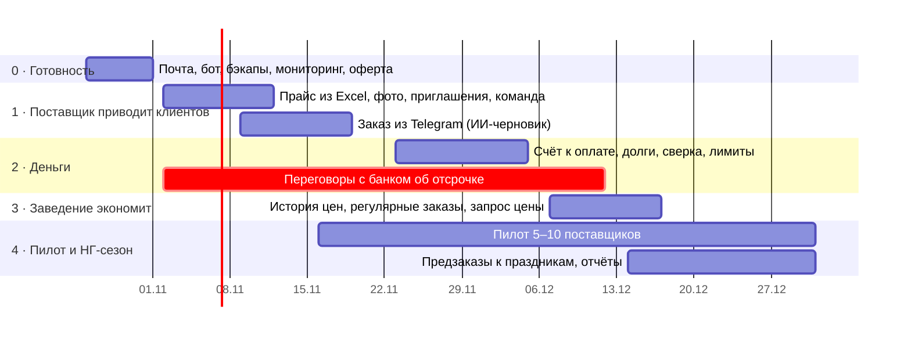

# QB — роадмап до Нового года (26.10 – 31.12.2026)

> v0.1 · 22.10.2026 · опирается на разбор конкурентов (Choco, Pepper, Ordermentum, GFC Food Ex, Supy) и на то,
> что уже сделано (docs/05, docs/06)

**Цель к Новому году:** QB работает с настоящими компаниями в Ереване — **5–10 поставщиков и 30+ заведений**,
у которых заказы идут через QB, а не только через мессенджеры.

**Главная ставка:** поставщик приводит своих клиентов сам (0% комиссии на них), потому что QB экономит ему работу:
заказы из Telegram превращаются в заказы QB, прайс загружается из Excel, документы и учёт оплат — сами.
Комиссию платформа берёт с новых клиентов, которых привела она.

## Этап 0 · Готовность к настоящим пользователям (26.10 – 1.11)

| Фича | Зачем | Кто |
|---|---|---|
| Подтвердить `ayoo.space` в Resend (MX для `send`) | Коды и уведомления доходят всем, а не только владельцу | вы: решение по почте домена; я: записи |
| Telegram-бот: токен от @BotFather | Уведомления в Telegram, дальше — приём заказов | вы: создать бота; я: подключить |
| Pay As You Go + лимит $1 в Oracle | Машину не остановят за простой | вы |
| Резервные копии вне сервера (Oracle Object Storage или на Mac по расписанию) | Сейчас копии лежат на той же машине | я |
| Мониторинг: проверка доступности + ошибки сервера на почту | Узнать о падении раньше клиентов | я |
| Оферта, политика данных, галочка при регистрации | Без них нельзя брать документы настоящих компаний | вы: текст (юрист); я: экран и учёт согласий |
| Убрать демо-компании с сервера (или отдельный демо-стенд) | Демо-товары сейчас видны всем гостям | я |

**Готово, когда:** чужой человек регистрируется, получает код на почту, видит только настоящих поставщиков.

## Этап 1 · Поставщик приводит клиентов (2.11 – 22.11)

| Фича | Что именно |
|---|---|
| **Прайс из Excel / CSV** | Загрузка файла → сопоставление колонок → предпросмотр с ошибками → обновление цен и остатков; повторная загрузка обновляет, а не дублирует (по артикулу) |
| **Фото товаров** | До 3 фото на товар, сжатие на сервере |
| **Приглашение клиентов** | Ссылка и QR от поставщика: клиент регистрируется и сразу попадает к нему с 0% комиссии; список «мои клиенты» |
| **Команда компании** | Пригласить сотрудника по почте с ролью; запрос на вступление в уже зарегистрированную компанию (сейчас второй человек упирается в «уже в QB») |
| **Заказ из Telegram** | Заведение пишет боту как привыкло («5 кг лори, 2 ящика помидоров на завтра», голосовое, фото списка) → ИИ (Claude) собирает черновик по каталогу поставщика → заведение подтверждает кнопкой → обычный заказ QB с торгом и документами |
| Страница поставщика | Публичная ссылка `qb.ayoo.space/s/<поставщик>` с каталогом — ставить в Instagram и визитки |

**Готово, когда:** поставщик за 15 минут загрузил прайс и отправил ссылку клиентам; заказ из Telegram доходит
до подтверждения без ручного ввода.
**Метрика:** доля заказов пилотных поставщиков, пришедших через QB (цель — 30% к концу этапа 4).

## Этап 2 · Деньги (23.11 – 6.12)

| Фича | Что именно |
|---|---|
| **Счёт к оплате со ссылкой** | В счёте реквизиты и QR для перевода; отметка «оплачено» продавцом или покупателем с подтверждением другой стороны |
| **Долги и напоминания** | Срок оплаты по клиенту (продавец задаёт: предоплата / в день доставки / 7 / 14 / 30 дней); напоминание за день и в день срока; список «просрочено» |
| **Кредитный лимит клиента** | Продавец задаёт лимит; при превышении заказ требует предоплаты (стоп-отгрузка, как у Ordermentum) |
| **Акт сверки** | За период по клиенту: заказы, оплаты, сальдо — PDF по форме РА |
| Оплата онлайн | Только после выбора банка-партнёра и проверки условий эквайринга — может уйти на январь |

Параллельно (вы): переговоры с 1–2 банками (Ameriabank, IDBank, Inecobank) об отсрочке для заведений:
банк платит поставщику сразу, заведение возвращает банку через 14–30 дней.

**Готово, когда:** поставщик видит, кто сколько должен и с какого дня, и не звонит клиентам с напоминаниями.

## Этап 3 · Заведение экономит (7.12 – 20.12)

| Фича | Что именно |
|---|---|
| **История цен** | По каждому товару: как менялась цена у поставщика и что платили вы; предупреждение «лори подорожал на 8%» |
| **Регулярные заказы** | «Каждый вторник и пятницу: 10 кг лори» — черновик создаётся сам, приходит уведомление «проверьте и отправьте» |
| **Избранное и шаблоны** | Свои списки закупок: «бар на выходные», «открытие смены» |
| **Запрос цены (RFQ)** | «К пятнице 50 кг говядины» → нескольким поставщикам → сравнение ответов → заказ у лучшего |

**Готово, когда:** у заведения есть причина открывать QB каждый день, даже без нового поставщика.

## Этап 4 · Пилот и новогодний сезон (16.11 – 31.12, параллельно)

| Что | Как |
|---|---|
| Пилот | 5–10 поставщиков (сыр, овощи, расходники, кофе, алкоголь) и их клиенты; созвон раз в неделю, правки по ходу |
| Предзаказы к праздникам | Поставщик открывает «праздничный прайс» с датами доставки 27–31.12; заведение бронирует объём заранее |
| Отчёты | Поставщику: продажи по клиентам и товарам, средняя скидка торга. Заведению: закупки по поставщикам и категориям за месяц |
| Обратная связь | Кнопка «что неудобно?» в приложении → в чат команды |

## Что сознательно после Нового года (Q1 2027)

| Фича | Почему не сейчас |
|---|---|
| Отсрочка через банк | Зависит от договора с банком |
| Совместная закупка нескольких кафе | Нужен объём пользователей |
| Гостиницы: бюджеты и согласование закупок | Отдельный сегмент, начать после пилота с кафе |
| Распознавание бумажных накладных (ИИ) | Ценно для заведения, но не приводит поставщиков |
| Себестоимость блюд и склад | Конкуренция с Supy / MarketMan — сначала закупки |
| e-счета и путевые листы КГД по API | Нет открытого API; сейчас вводим номера вручную |
| Грузия (Тбилиси, Батуми) | После того как модель сработала в Ереване |
| Web push на телефон | Колокольчик, почта и Telegram закрывают нужду |

## Риски

| Риск | Что делаем |
|---|---|
| Поставщики не хотят «ещё одну систему» | Начинаем с Telegram-заказов и документов: им не надо менять привычки клиентов |
| Нет банка к январю | Отсрочка на условиях самого поставщика (лимиты, сроки) — уже польза |
| Бесплатный сервер на 1 ядро | Хватит на пилот; при росте — 2 ядра (когда освободятся) или платная машина ~$15/мес |
| Один разработчик (я) | Этапы по 2 недели, каждый заканчивается рабочей частью на сервере; если сдвигаемся — режем этап 3, не 1 |
